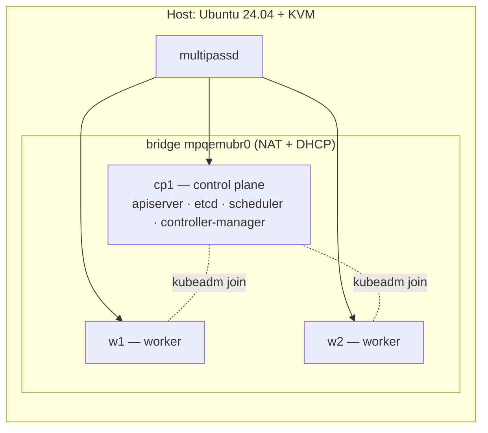

This guide builds a real Kubernetes cluster — one control-plane node and two workers — on local virtual machines, with `kubeadm`. Not minikube, not kind, not a managed cluster: it is the same installation an administrator does in production, and the only honest way to prepare for the CKA exam.

Every command here was run and its output verified. The errors in the traps section happened during the installation; they are not hypotheticals. The original notes (in Spanish) live in my [kubestronaut repo](https://github.com/Carlosposada-Dev/kubestronaut/blob/main/lab/lab-kubeadm-3-nodos-tutorial.md), next to the CKA runbooks this lab is built for.

> **Tested on:** Ubuntu 24.04.4 LTS (bare metal, KVM) · multipass 1.16.3 · Kubernetes v1.34.11 · containerd 2.2.1 · Calico v3.32.2 — verified on 2026-08-31, about two hours end to end. I have only run it on a Linux host; on Windows, macOS or inside WSL2 multipass uses a different backend, and I have not verified those paths.

## Why kubeadm and not a managed cluster

If your day job is EKS, GKE or AKS, the provider hides the control plane from you. You never see the certificates, never touch etcd, never install a CNI, and nodes are born `Ready` as if by magic. That is great for production and terrible for learning.

With kubeadm all of that is your job, and that is where the learning is. Throughout the guide I flag every point where a managed cluster behaves differently, because those are exactly the blind spots the exam goes after.

## Requirements

| Resource | Minimum | Used here |
|---|---|---|
| CPU | 6 threads | Ryzen 5 3600 (6c/12t) |
| RAM | 16 GB | 48 GB |
| Free disk | 40 GB | — |
| Host OS | Linux with KVM | Ubuntu 24.04 |

Each VM gets **2 vCPU and 4 GB**. The control-plane node's 2 vCPU are not negotiable — `kubeadm init` has a preflight check that fails with fewer.

## Design decisions

| Decision | Choice | Why |
|---|---|---|
| Hypervisor | multipass (QEMU/KVM) | Native snapshots and Ubuntu VMs in one command |
| K8s version | v1.34 | When I wrote this the CKA ran v1.35. Installing 1.34 leaves `kubeadm upgrade` as a real exercise |
| CNI | **Calico** | Flannel **does not implement NetworkPolicy**. If you are heading for CKS, picking Flannel means rebuilding the cluster |
| Pod CIDR | `10.244.0.0/16` | Calico's default (`192.168.0.0/16`) collides with typical home networks |
| Runtime | containerd | No Docker. Dockershim has been gone since v1.24 |

A point of vocabulary worth fixing early: what you create are **three nodes**, one of them a *control-plane node*. The control plane is not the machine — it is the set of components (apiserver, etcd, scheduler, controller-manager) running on that node.



## Where each command runs — read this before copying anything

In a three-node lab you jump between four machines: your host and the three VMs. **The most expensive mistake in the whole build is not technical: it is running the right command on the wrong machine.**

That is why every command block below carries a badge with the machine it runs on — `HOST`, `cp1`, `w1`. Blocks with a dashed border and no badge are output: what you should see, not what you type. Until Phase 6 almost everything runs on the host and reaches the nodes through `multipass exec`.

And pick up this habit, which costs one second and saves an hour:

```bash host=HOST
hostname
```

**Before any `sudo`, `hostname`.** It is the cheapest check there is, and the only one that stops you from deleting a manifest on the wrong node.

## Phase 0 — Prepare the host

### 0.1 Check that virtualization is on

```bash host=HOST
egrep -c '(vmx|svm)' /proc/cpuinfo
ls -l /dev/kvm
lsmod | grep kvm
```

You want a number greater than zero, `/dev/kvm` to exist, and `lsmod` to show `kvm_amd` (or `kvm_intel`) as well as `kvm`.

**Here is the first trap, and it is a common one.** The first command can return `12` — the CPU supports virtualization — and `/dev/kvm` can still be missing:

```
$ ls -l /dev/kvm
ls: cannot access '/dev/kvm': No such file or directory

$ sudo modprobe kvm_amd
modprobe: ERROR: could not insert 'kvm_amd': Operation not supported
```

`/proc/cpuinfo` reports what the **silicon** can do. Whether it is *enabled* is a different question, and the firmware decides it. The definitive diagnosis:

```bash host=HOST
sudo dmesg | grep -i -e svm -e kvm
```

```
[ 0.519418] SVM disabled (by BIOS) in MSR_VM_CR
[ 15.811944] kvm_amd: SVM not supported by CPU 11
```

`SVM disabled (by BIOS)` settles it. The `not supported by CPU` messages after it are a consequence, not a separate cause.

### 0.2 Enable SVM / VT-x in the UEFI

Reboot into the UEFI (usually `Del` or `F2`). Look for **SVM Mode** on AMD boards, or **Intel VT-x** on Intel:

| Vendor | Usual path |
|---|---|
| ASUS | Advanced → CPU Configuration → SVM Mode |
| MSI | OC → CPU Features → SVM Mode |
| Gigabyte | Tweaker / M.I.T. → Advanced CPU Settings → SVM Mode |
| ASRock | Advanced → CPU Configuration → SVM |

Set it to `Enabled`, save, and do a **full power-off** (some boards do not apply the change on a warm reboot).

If you also see **IOMMU / AMD-Vi**, it is almost never next to SVM — it usually lives under `Advanced → AMD CBS → NBIO Common Options → IOMMU`. **Leave it alone.** IOMMU is only needed for passing PCI devices through to a VM, which this guide does not do, and on some boards enabling it without configuring the groups properly causes boot or USB problems.

Dual-booting with Windows is fine: SVM is a firmware setting on the CPU and no operating system reverts it. The only notable side effect is that Windows 11 may turn on VBS / Memory Integrity, which costs a few FPS in games; you can switch it off from Windows without touching the UEFI.

#### Side note: when `reboot` refuses

```
$ sudo reboot
Operation inhibited by "cposada" (PID 4826 "gnome-session-s")...
```

systemd has **inhibitors**: processes that register "don't shut down yet". `delay` inhibitors only hold things for a few seconds; `block` inhibitors refuse. Before forcing anything, check who it is and why:

```bash host=HOST
systemd-inhibit --list | cat     # the `| cat` stops the MODE column from being cut off
ps aux | grep -e unattended -e packagekit -e apt
```

If an `apt` or `dpkg` is really installing something, **wait** — forcing it leaves packages half configured. If the only thing listed is `unattended-upgrade-shutdown --wait-for-signal`, that process is not updating anything: it is parked, waiting for a shutdown signal so it can *then* check whether something is in progress. It is a permanent block inhibitor by design, and in that case forcing is safe:

```bash host=HOST
sudo systemctl reboot -i
```

### 0.3 Post-UEFI validation

```bash host=HOST
sudo dmesg | grep -i svm      # must NOT say "disabled (by BIOS)" anymore
ls -l /dev/kvm                 # crw-rw----+ 1 root kvm
lsmod | grep kvm               # kvm ... 1 kvm_amd
sudo usermod -aG kvm $USER
```

The `+` in `crw-rw----+` means the device has an **ACL**: `systemd-logind` grants the active session's user access to `/dev/kvm` automatically, so you probably already work without logging out. Check it with `getfacl /dev/kvm | grep $USER`. The `usermod` is still a good safety net for non-interactive sessions.

### 0.4 Install multipass

```bash host=HOST
sudo snap install multipass
multipass version
multipass snapshot --help
```

**That last command is a gate, not decoration.** If `snapshot` does not exist, your multipass predates 1.13 → `sudo snap refresh multipass`. Without snapshots, do not build this lab: half its value is being able to break it and restore it in three minutes.

```bash host=HOST
df -h /var/snap                # at least 40 GB free
```

## Phase 1 — Create the three VMs

```bash host=HOST
for n in cp1 w1 w2; do
  multipass launch 24.04 --name $n --cpus 2 --memory 4G --disk 20G
done

multipass list
```

```
Name    State     IPv4              Image
cp1     Running   10.167.152.47     Ubuntu 24.04 LTS
w1      Running   10.167.152.24     Ubuntu 24.04 LTS
w2      Running   10.167.152.155    Ubuntu 24.04 LTS
```

Save the control-plane IP, you will use it several times:

```bash host=HOST
CP_IP=$(multipass info cp1 --format csv | awk -F, 'NR==2{print $3}')
echo $CP_IP
```

### Validation

```bash host=HOST
multipass exec w1 -- ping -c2 $CP_IP
```

Latencies in **tenths of a millisecond** confirm hardware acceleration. If you see tens of milliseconds, KVM is not in use and something in Phase 0 is half done.

### How these VMs live (and what happens when you stop them)

`multipassd` runs as root and starts one `qemu-system-x86_64` process per instance. No magic:

- **Disk:** one qcow2 file per instance under `/var/snap/multipass/common/data/multipassd/vault/instances/`. It is a copy-on-write overlay on the base image, thin-provisioned: you ask for 20 GB and it takes ~5 GB.
- **RAM:** taken by the qemu process only while the VM runs.
- **Network:** a virtual bridge `mpqemubr0` on the host, with NAT and a dnsmasq handing out DHCP. That is why the nodes can see each other.

`multipass stop` is an orderly ACPI shutdown. The qcow2 stays intact and, on start, systemd brings up `containerd` and `kubelet` because they were left `enabled`: **the cluster rebuilds itself in 1–2 minutes** without you doing anything.

The only real risk is **the control-plane node's IP changing**: that address is baked into the apiserver certificate SANs and into every kubeconfig. In practice it does not change, because each instance's MAC is stable and dnsmasq hands back the same lease. Check it **now**, with the VMs empty, not three months from now:

```bash host=HOST
multipass stop cp1 w1 w2 && multipass start cp1 w1 w2 && multipass list
sudo snap restart multipass && sleep 10 && multipass list
```

All three IPs must be identical after both tests. (The `sleep` is needed because `snap restart` returns before `multipassd` opens its socket; without it you get `cannot connect to the multipass socket`, which is not a real error.)

**About suspending the host:** after waking from S3, the *guest* clock had jumped by hours. Kubernetes is time-sensitive: Leases expire, leaders get re-elected, and you will see nodes `NotReady` for a couple of minutes. It recovers on its own, but don't draw conclusions from what you see right after waking up. Hibernating the host or a hard hang, on the other hand, are the same as pulling the plug and can corrupt etcd. Rule: `multipass stop --all` before calling it a day.

## Phase 2 — Prepare the three nodes

These five steps are identical on the three nodes, so they go in a script.

```bash host=HOST title="prep-node.sh"
cat > prep-node.sh <<'SCRIPT'
#!/usr/bin/env bash
set -euo pipefail
K8S_MINOR="${K8S_MINOR:-v1.34}"

# 1. Swap off. The kubelet refuses to start with swap on.
sudo swapoff -a
sudo sed -i '/\sswap\s/s/^/#/' /etc/fstab

# 2. Modules and sysctl. Without br_netfilter, bridged traffic skips
#    iptables and kube-proxy does not work.
printf 'overlay\nbr_netfilter\n' | sudo tee /etc/modules-load.d/k8s.conf
sudo modprobe overlay && sudo modprobe br_netfilter

cat <<EOF | sudo tee /etc/sysctl.d/k8s.conf
net.bridge.bridge-nf-call-iptables  = 1
net.bridge.bridge-nf-call-ip6tables = 1
net.ipv4.ip_forward                 = 1
EOF
sudo sysctl --system >/dev/null

# 3. containerd with the systemd cgroup driver.
#    A mismatch here is the number one cause of "the kubelet won't start".
sudo apt-get update -qq
sudo apt-get install -y -qq containerd apt-transport-https ca-certificates curl gpg
sudo mkdir -p /etc/containerd
containerd config default | sudo tee /etc/containerd/config.toml >/dev/null
sudo sed -i 's/^\(\s*\)SystemdCgroup = false/\1SystemdCgroup = true/' /etc/containerd/config.toml
sudo systemctl restart containerd && sudo systemctl enable containerd

# 4. crictl pointing at the right socket
cat <<EOF | sudo tee /etc/crictl.yaml
runtime-endpoint: unix:///run/containerd/containerd.sock
image-endpoint: unix:///run/containerd/containerd.sock
timeout: 10
EOF

# 5. Kubernetes packages
sudo mkdir -p /etc/apt/keyrings
sudo rm -f /etc/apt/keyrings/kubernetes-apt-keyring.gpg
curl -fsSL "https://pkgs.k8s.io/core:/stable:/${K8S_MINOR}/deb/Release.key" \
  | sudo gpg --dearmor -o /etc/apt/keyrings/kubernetes-apt-keyring.gpg
echo "deb [signed-by=/etc/apt/keyrings/kubernetes-apt-keyring.gpg] https://pkgs.k8s.io/core:/stable:/${K8S_MINOR}/deb/ /" \
  | sudo tee /etc/apt/sources.list.d/kubernetes.list
sudo apt-get update -qq
sudo apt-get install -y -qq kubelet kubeadm kubectl
sudo apt-mark hold kubelet kubeadm kubectl
SCRIPT
chmod +x prep-node.sh

for n in cp1 w1 w2; do
  multipass transfer prep-node.sh $n:/home/ubuntu/prep-node.sh
  multipass exec $n -- bash /home/ubuntu/prep-node.sh
done
```

It takes 3 to 5 minutes for the three nodes. Notes on the script:

- **`apt-mark hold`** stops a routine system update from moving your Kubernetes version under your feet. When you really want to upgrade, `apt-mark unhold` is the first step of the procedure.
- **`SystemdCgroup = true`** is the setting that fails most silently. The `sed` depends on finding the exact line in the generated TOML, and the format changes between containerd major versions. That is why it is verified below.
- The `rm -f` on the keyring stops `gpg --dearmor` from failing if you run the script again.

### Validation — five lines per node, fifteen in total

```bash host=HOST
for n in cp1 w1 w2; do
  echo "--- $n"
  multipass exec $n -- bash -c '
    swapon --show | wc -l                                          # 0
    systemctl is-active containerd                                 # active
    grep -c "SystemdCgroup = true" /etc/containerd/config.toml     # 1
    sysctl -n net.ipv4.ip_forward                                  # 1
    kubeadm version -o short'
done
```

```
--- cp1
0
active
1
1
v1.34.11
```

If the third value comes out `0`, **stop here**: the `sed` did not find the line and the kubelet will not start later. Open `/etc/containerd/config.toml` and fix it by hand.

> **A note on versions:** Ubuntu 24.04 installs **containerd 2.2.1** today, quite a bit newer than most guides assume. The `sed` still works, but that is exactly why this step is verified instead of taken for granted.

## Phase 3 — `kubeadm init` and the CNI

```bash host=HOST
multipass exec cp1 -- sudo kubeadm init \
  --apiserver-advertise-address=$CP_IP \
  --pod-network-cidr=10.244.0.0/16 \
  --node-name=cp1 | tee kubeadm-init.log
```

**Keep the log.** It contains the `join` command you need later.

It is worth reading the output instead of waiting for it to finish, because it tells you exactly what a control plane does:

```
[certs] Generating "ca" certificate and key
[certs] apiserver serving cert is signed for DNS names [...] and IPs [10.96.0.1 10.167.152.47]
[kubeconfig] Writing "admin.conf" kubeconfig file
[kubeconfig] Writing "super-admin.conf" kubeconfig file
[etcd] Creating static Pod manifest for local etcd in "/etc/kubernetes/manifests"
[control-plane] Creating static Pod manifest for "kube-apiserver"
[kubelet-start] Starting the kubelet
[wait-control-plane] Waiting for the kubelet to boot up the control plane as static Pods
[mark-control-plane] Marking the node cp1 ... taints [node-role.kubernetes.io/control-plane:NoSchedule]
```

That is the whole mechanism: kubeadm **does not start** the control plane. It writes four YAML files to `/etc/kubernetes/manifests/` and lets the kubelet discover them. The kubelet is the only component that can run Pods before an API server exists, because it reads from disk, not from the API.

If you see this line, it is informational and not a problem:

```
remote version is much newer: v1.37.0; falling back to: stable-1.34
```

kubeadm looked up the latest stable release and respected your minor. Exactly what we want.

### kubeconfig

```bash host=HOST
# Inside the node
multipass exec cp1 -- bash -c '
  mkdir -p $HOME/.kube
  sudo cp /etc/kubernetes/admin.conf $HOME/.kube/config
  sudo chown $(id -u):$(id -g) $HOME/.kube/config'

# And on the host, which is where you will work from for now
mkdir -p ~/.kube
multipass exec cp1 -- sudo cat /etc/kubernetes/admin.conf > ~/.kube/config

kubectl get nodes
```

```
NAME   STATUS     ROLES           AGE   VERSION
cp1    NotReady   control-plane   27s   v1.34.11
```

**`NotReady` is the correct result at this point.** A vanilla cluster is born without a network. `kubectl get pods -n kube-system` shows both CoreDNS Pods `Pending` for the same reason: there is no network to place them on.

This is exactly the point a managed cluster hides from you: there the CNI comes preinstalled and the node is born `Ready`, so you never see this intermediate phase or learn to diagnose it.

### Install Calico

```bash host=HOST
CALICO_VER=$(curl -s https://api.github.com/repos/projectcalico/calico/releases/latest \
             | grep -oP '"tag_name": "\K[^"]+')
echo $CALICO_VER          # v3.32.2 when I wrote this

kubectl create -f https://raw.githubusercontent.com/projectcalico/calico/${CALICO_VER}/manifests/tigera-operator.yaml
curl -sLO https://raw.githubusercontent.com/projectcalico/calico/${CALICO_VER}/manifests/custom-resources.yaml
sed -i 's#192.168.0.0/16#10.244.0.0/16#' custom-resources.yaml
kubectl create -f custom-resources.yaml
```

Resolving the version through the GitHub API avoids pinning a URL that goes stale in three months.

These are two steps with different jobs: `tigera-operator.yaml` installs the **operator**, and `custom-resources.yaml` creates the `Installation` object that tells it *what* to deploy and with which CIDR. If you skip the `sed`, Calico uses `192.168.0.0/16` and it won't match the `--pod-network-cidr` from the init.

### Validation

```bash host=HOST
kubectl get pods -n calico-system
kubectl get nodes
kubectl get pods -n kube-system
```

Give it 1–3 minutes. The Pod that matters is **`calico-node`**: as soon as it is `Running`, the node turns `Ready` and CoreDNS goes from `Pending` to `Running`. The operator's other components (`calico-apiserver`, `goldmane`, `whisker`) finish pulling images afterwards and block nothing.

## Phase 4 — Join the workers

```bash host=HOST
JOIN=$(multipass exec cp1 -- sudo kubeadm token create --print-join-command)
echo "$JOIN"

for n in w1 w2; do multipass exec $n -- sudo $JOIN; done
```

The token `kubeadm init` printed **expires after 24 hours**. `token create --print-join-command` regenerates it, and it is the reproducible path.

```bash host=HOST
kubectl get nodes -o wide
kubectl label node w1 node-role.kubernetes.io/worker=
kubectl label node w2 node-role.kubernetes.io/worker=
kubectl get nodes
```

The workers show `NotReady` for ~40 seconds: the Calico DaemonSet has to place a `calico-node` on each one. It is the same cycle you went through with `cp1`, compressed.

The `node-role.kubernetes.io/worker=` label is purely cosmetic — `kubectl get nodes` does not infer the role from anything else.

A `kube-proxy` warning recommending `bindAddress` `::` instead of `0.0.0.0` is normal and needs no action.

### Validation

```bash host=HOST
kubectl get nodes
kubectl get pods -n calico-system -o wide | grep calico-node
```

Three nodes `Ready`, and **one `calico-node` per node**. If a node is missing its own, that is why it is still `NotReady`.

## Phase 5 — Acceptance tests

Six checks. None of them is ceremonial: each one teaches something a managed cluster won't let you see.

### 1. The control-plane taint

```bash host=HOST
kubectl describe node cp1 | grep -i -A2 -i taint
```

```
Taints:  node-role.kubernetes.io/control-plane:NoSchedule
```

### 2. The static Pods, on disk

```bash host=HOST
multipass exec cp1 -- sudo ls -l /etc/kubernetes/manifests/
```

```
etcd.yaml  kube-apiserver.yaml  kube-controller-manager.yaml  kube-scheduler.yaml
```

Careful: those files live **inside the node**. A `cat /etc/kubernetes/...` from the host fails with `No such file or directory`, and it is easy to get confused while you jump between the two machines.

### 3. Confirm they are mirror Pods

```bash host=HOST
kubectl get pod kube-apiserver-cp1 -n kube-system \
  -o jsonpath='{.metadata.annotations.kubernetes\.io/config\.mirror}{"\n"}'
```

It must print a hash. A mirror Pod is a **read-only** reflection of the real Pod the kubelet manages: deleting it with `kubectl delete` stops nothing, because the kubelet recreates it from the file. To stop a static Pod you move its YAML out of the directory.

### 4. Internal DNS and ClusterIP connectivity

```bash host=HOST
kubectl run t --image=busybox:1.28 --restart=Never -it --rm -- \
  sh -c 'nslookup kubernetes.default; wget -qO- -T3 10.96.0.1:443 2>&1 | head -1'
```

```
Server:    10.96.0.10
Name:      kubernetes.default
Address 1: 10.96.0.1 kubernetes.default.svc.cluster.local
wget: server returned error: HTTP/1.0 400 Bad Request
```

The `400 Bad Request` is **correct**: you are speaking plain HTTP to a port that expects TLS. What is being tested is that the connection gets there, not that it authenticates. Three layers verified in one go: CoreDNS, kube-proxy and the pod → Service → ClusterIP path.

> **Use `busybox:1.28`, not a newer version.** Later versions have a known `nslookup` bug that breaks short-name resolution inside Kubernetes; the official docs pin the image to `1.28` for that reason. With `busybox:1.36` you get `NXDOMAIN` and think your DNS is broken when it isn't. A perfect trap: the symptom points at CoreDNS and the cause is in the test image.

### 5. Real scheduling

```bash host=HOST
kubectl create deploy web --image=nginx --replicas=4
sleep 15
kubectl get pods -o wide
kubectl delete deploy web
```

The four replicas must spread across `w1` and `w2`, **none on `cp1`**. That is the functional proof that the taint does its job.

### 6. Certificates

```bash host=HOST
multipass exec cp1 -- sudo kubeadm certs check-expiration
```

```
CERTIFICATE     EXPIRES                  RESIDUAL TIME   CERTIFICATE AUTHORITY
apiserver       Aug 31, 2027 19:46 UTC   364d            ca
admin.conf      Aug 31, 2027 19:46 UTC   364d            ca
...
CERTIFICATE AUTHORITY   EXPIRES                  RESIDUAL TIME
ca                      Aug 28, 2036 19:46 UTC   9y
etcd-ca                 Aug 28, 2036 19:46 UTC   9y
```

The pattern is worth memorizing: **leaf certificates for 1 year, CAs for 10 years** (the column shows `9y` because it rounds down, just as it shows `364d` for a year). The asymmetry is intentional: CAs sign, so they live longer.

Leaf certificates renew themselves on every `kubeadm upgrade`. If the cluster is never upgraded, someone has to remember `kubeadm certs renew` before the year is up. On a managed cluster that someone is the provider, and you never find out.

### Extra: metrics-server

It is not included, and without it `kubectl top` does not work:

```bash host=HOST
kubectl apply -f https://github.com/kubernetes-sigs/metrics-server/releases/latest/download/components.yaml
kubectl -n kube-system patch deploy metrics-server --type=json \
  -p='[{"op":"add","path":"/spec/template/spec/containers/0/args/-","value":"--kubelet-insecure-tls"}]'
sleep 60
kubectl top nodes
```

The `--kubelet-insecure-tls` patch is needed because the kubelet's serving certificates are self-signed in a default kubeadm install. **Fine for a lab, not for production.**

## Phase 6 — Set up the working environment

This phase is missing from every kubeadm guide I have read, and it is the one that saves the most time over the following months. **It comes before the snapshots on purpose**: if you snapshot first, every restore wipes your aliases, your `.vimrc` and your SSH keys, and you end up reconfiguring the environment twenty times.

An important framing point: in the CKA exam you get a ready terminal, on a node from which you jump to the others without a password. **Your lab doesn't have that, and you have to build it.** It is environment infrastructure, not study material — but without it every exercise starts with friction.

### 6.1 Decide where you work from

So far you have driven the cluster from the host with `multipass exec`. For CKA practice that is wrong, and it is worth changing now: **the exam puts you inside a node**, not on an external machine with a `kubeconfig`. Work from `cp1` and leave it only to manage the VMs.

```bash host=HOST
multipass shell cp1
```

Two notices you will see in `cp1`'s welcome banner, and what to do with each:

- **`*** System restart required ***`** — normal after the install. You don't need to reboot to work; it can wait until it suits you.
- **`N updates can be applied immediately`** — **never run `apt upgrade` on a cluster node.** Your Kubernetes packages are on `hold`, but `apt upgrade` is exactly how a version moves without you asking. If you need to install something, always be explicit: `sudo apt-get install <package>=<version>`.

Also check that there isn't a newer `kubectl` hiding on the host (a snap, a binary in `/usr/local/bin`). A `kubectl` two minors ahead of the cluster produces warnings and odd behaviour that will have you hunting for a problem that doesn't exist:

```bash host=HOST
which -a kubectl && kubectl version --client
```

### 6.2 Aliases and shell environment

```bash host=cp1
hostname                     # cp1 → go ahead

cat >> ~/.bashrc <<'EOF'
# ---- CKA ----
source <(kubectl completion bash)
alias k=kubectl
complete -o default -F __start_kubectl k
export do="--dry-run=client -o yaml"
export now="--force --grace-period=0"
alias kn='kubectl config set-context --current --namespace'
alias kgp='kubectl get pods -o wide'
alias kga='kubectl get all -A'
alias kd='kubectl describe'
alias kx='kubectl explain --recursive'
export KUBE_EDITOR=vim
export ETCDCTL_API=3
# ---- end CKA ----
EOF

printf 'set ts=2 sw=2 et ai nu\nsyntax on\n' > ~/.vimrc
echo "export PS1='\[\e[1;31m\]\h\[\e[0m\]:\w\$ '" >> ~/.bashrc
source ~/.bashrc
```

The `PS1` paints the hostname red in the prompt. It sounds cosmetic and it isn't: it is the same defence as the `hostname` habit above, made permanent.

#### Validation

```bash host=cp1
type __start_kubectl        # must exist → completion is on
echo $do                     # --dry-run=client -o yaml
k version --client           # the alias answers
```

The prompt should look like `cp1:~$` with the hostname coloured.

#### How to use them — real examples

The `.vimrc` matters as much as the aliases: `et` (spaces instead of tabs) keeps YAML pasted into vim from breaking on indentation, and `nu` gives you line numbers to jump around quickly with `:42`.

| Goal | With the aliases |
|---|---|
| Imperative Pod | `k run web --image=nginx` |
| Pod YAML skeleton | `k run web --image=nginx $do > pod.yaml` |
| Deployment with replicas | `k create deploy api --image=nginx --replicas=3` |
| Deployment YAML to edit | `k create deploy api --image=nginx $do > d.yaml` |
| Instant delete | `k delete pod web $now` |
| Switch the default namespace | `kn kube-system` |
| Pods with node and IP | `kgp` |
| Whole-cluster X-ray | `kga` |
| Diagnose a Pod | `kd pod web` |
| Find a field without leaving the terminal | `kx pod.spec.containers.livenessProbe` |

The pattern that solves half the exam is always the same: **generate with `$do`, edit what can't be done imperatively, apply.**

```bash host=cp1
k create deploy api --image=nginx --replicas=3 $do > d.yaml
vim d.yaml          # this is where you add probes, resources, volumes, tolerations
k apply -f d.yaml
```

> **An honest warning about aliases.** The exam has **no preinstalled helpers**: if you want aliases, you type them at the start, against the clock. So having them in the lab is not enough — you have to practise **writing them from memory**. Make it a two-minute ritual at the start of every study session: type the whole block by hand, no copying, before you begin. If you can't reproduce it in two minutes, in the exam it will cost you more than it saves.
>
> And keep a mental plan B: if the aliases fail or you get one wrong, full `kubectl` works just the same. Never depend on `k` so much that you freeze without it.

### 6.3 Passwordless SSH from cp1 to the workers

In the exam you jump between nodes with `ssh <node>` and it just works. Here you have to build it.

```bash host=cp1
ssh-keygen -t ed25519 -N '' -f ~/.ssh/id_ed25519
cat ~/.ssh/id_ed25519.pub          # ← copy this whole line
```

Open a **second terminal** on the host, without closing the `cp1` one:

```bash host=HOST title="second terminal"
for n in w1 w2; do
  multipass exec $n -- bash -c "echo '<PASTE_THE_PUBLIC_KEY_HERE>' >> ~/.ssh/authorized_keys"
done
```

Back on `cp1`, define the shortcuts:

```bash host=cp1
cat >> ~/.ssh/config <<'EOF'
Host w1
  HostName 10.167.152.24
  User ubuntu
  StrictHostKeyChecking no
Host w2
  HostName 10.167.152.155
  User ubuntu
  StrictHostKeyChecking no
EOF
chmod 600 ~/.ssh/config
```

Replace the IPs with yours. `StrictHostKeyChecking no` is acceptable in a disposable lab you will restore constantly; **in production, no**.

#### Validation

```bash host=cp1
ssh w1 hostname && ssh w2 hostname
```

It must print `w1` and `w2`, without asking for a password or about the host fingerprint. From here on you can close the second host terminal and always work from `cp1`.

This is not about comfort: half the CKA tasks on nodes — stopping the kubelet, moving a manifest, reading containerd logs, a `drain` followed by maintenance — require being *inside* the worker. Without SSH, every one of them starts with a detour through the host.

## Phase 7 — Snapshots

The phase that turns this into a lab instead of an installation.

**Take the snapshot now, after Phase 6.** That way every restore gives you back a clean cluster *with* your aliases, your `.vimrc` and your SSH already in place.

```bash host=HOST
multipass stop cp1 w1 w2
for n in cp1 w1 w2; do multipass snapshot $n --name clean-v134; done
multipass start cp1 w1 w2
multipass list --snapshots
```

> **Snapshot names can't contain dots.** `clean-1.34` fails with `Invalid snapshot name`. They follow the same rules as instance names — basically hostname rules. Use `clean-v134`.

To restore:

```bash host=HOST
multipass stop cp1 w1 w2
for n in cp1 w1 w2; do multipass restore --destructive $n.clean-v134; done
multipass start cp1 w1 w2
kubectl get nodes
```

Time the full cycle once. On the reference hardware it takes **3 minutes**. If yours goes past five, you won't break the cluster often enough to learn from it, and it is worth optimizing.

## Traps and real errors

A summary of everything that went wrong during this installation, because it is more useful than the version where everything works first time.

| Symptom | Real cause | Fix |
|---|---|---|
| `/dev/kvm` missing even though `/proc/cpuinfo` shows `svm` | SVM disabled in the UEFI | `dmesg \| grep -i svm` confirms it; enable SVM Mode |
| `reboot` refused by an inhibitor | `unattended-upgrade-shutdown` blocks by design | Check no real `apt` is running, then `systemctl reboot -i` |
| `cannot connect to the multipass socket` | `snap restart` returns before the socket is open | Wait 10 s and retry |
| `nslookup` returns NXDOMAIN inside the cluster | `nslookup` bug in busybox > 1.28 | Use `busybox:1.28` |
| `Invalid snapshot name: "clean-1.34"` | Snapshot names can't contain dots | `clean-v134` |
| `Error from server (AlreadyExists)` when reapplying Calico | `kubectl create` is not idempotent | Noise if the resource already existed; `kubectl apply` to reapply |
| The terminal hangs after `kubectl get ... -w` | `-w` is a permanent watch | `Ctrl+C`; for a one-off check, drop `-w` |
| `couldn't attach to pod, falling back to streaming logs` | Race between `-it --rm` and single-command containers | Cosmetic; the output is duplicated but valid |
| The kubelet won't start after the install | cgroup driver mismatch between kubelet and containerd | `SystemdCgroup = true` in `/etc/containerd/config.toml` |
| The Kubernetes version changed without asking | `apt upgrade` on a node | **Never `apt upgrade` on a node.** Only `apt-get install <pkg>=<version>` |
| Odd `kubectl` warnings, inconsistent behaviour | A host `kubectl` (snap or `/usr/local/bin`) several minors ahead of the cluster | `which -a kubectl`; work from `cp1` or align versions |
| Aliases and SSH keys gone after restoring a snapshot | The snapshot was taken before setting up the environment | Set up shell and SSH **before** the snapshot (Phase 6 → Phase 7) |
| Command run on the wrong machine | Four terminals open and no indicator | `hostname` before every `sudo`; coloured hostname in `PS1` |

## Managed vs vanilla — the summary

| Behaviour | Managed cluster (EKS/GKE/AKS) | kubeadm |
|---|---|---|
| Control-plane components | In a provider account, invisible | Static Pods in `/etc/kubernetes/manifests/` |
| `kubectl get nodes` | Workers only | Includes the control-plane node, with its taint |
| CNI | Preinstalled; nodes are born `Ready` | **Nothing included.** `NotReady` until you install one |
| etcd access | None; the provider takes backups | `etcdctl` on the node. **The backup is yours** |
| PKI | Invisible | Three CAs, yours to renew. Certificates last 1 year |
| Identity | An IAM principal mapped to a user/group | The CN and O of an x509 certificate |
| Installation | Terraform / console / provider CLI | `kubeadm init` + `join` + CNI by hand |
| Upgrade | One API call | `kubeadm upgrade plan/apply` + `drain`/`uncordon` |
| `type: LoadBalancer` | A load balancer just appears | `<pending>` forever; there is no cloud-controller-manager |
| `kubectl top` | Usually ready | You install metrics-server yourself |

The rule that sums it up: **every point where the provider does something automatically is a point where you need to know what is really happening.**

## What to do with the cluster now

With the snapshot taken, the cluster is disposable. That enables the only kind of practice that works for a hands-on exam: breaking things on purpose and fixing them against the clock.

A pattern that works well is a small harness of scripts, each with four pieces: `break`, `verify`, `fix` and an array of escalating hints. Here is a sketch of one:

```bash host=HOST title="breaks/01-scheduler-down.sh"
#!/usr/bin/env bash
TITLE="New Pods stay Pending"
TARGET_MIN=6

do_break() { multipass exec cp1 -- sudo mv /etc/kubernetes/manifests/kube-scheduler.yaml /root/; }
do_fix()   { multipass exec cp1 -- sudo mv /root/kube-scheduler.yaml /etc/kubernetes/manifests/; }
do_verify() {
  kubectl run chk --image=nginx --restart=Never >/dev/null 2>&1
  sleep 20
  [ -n "$(kubectl get pod chk -o jsonpath='{.spec.nodeName}')" ]
}
HINTS=(
  "Create a Pod. Does it ever get a node assigned?"
  "kubectl describe pod — are there events, or NONE at all?"
  "No FailedScheduling means nobody looked at it. Who was supposed to, and where does it live?"
)
```

Two design decisions that matter:

**The tooling lives on the host, not inside the nodes.** If you break the kubelet or containerd on the node your tooling runs on, you lose both at once. From the host you have `kubectl` and `multipass exec` to all three nodes: enough to break things and to verify them.

**Hints come from a pre-written array, not from an assistant.** A language model you ask "don't help me until I try" always gives in eventually. An array is deterministic and honest. If you want to ask someone, do it by describing symptoms — which is exactly what you will do in a real incident.

The highest-value breaks are the ones an online practice environment won't let you touch: static Pods, etcd, certificates, kubelet, CNI and upgrades. In other words, precisely the control plane a managed cluster hides from you.

And remember the cluster runs v1.34 on purpose: upgrading it to v1.35 with `kubeadm upgrade`, `drain` and `uncordon`, one node at a time, is the natural next exercise.
